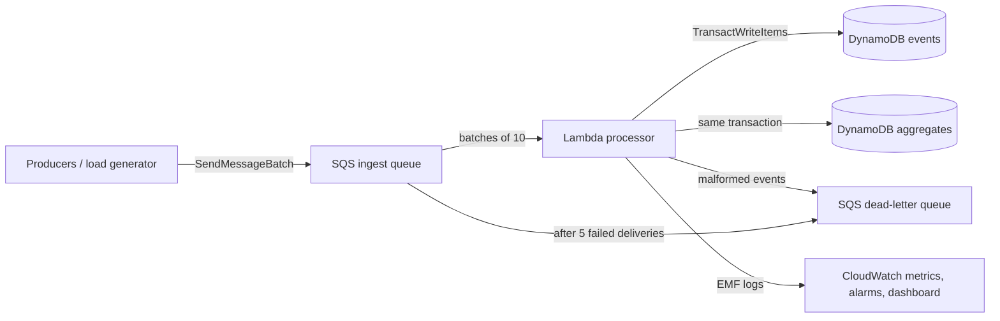
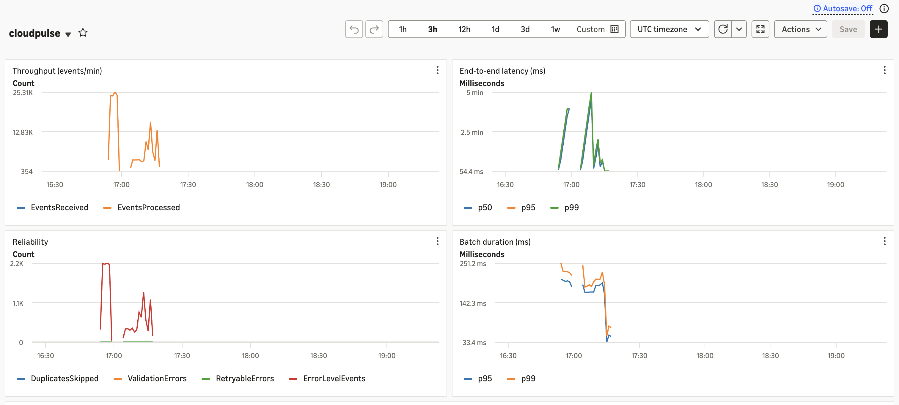
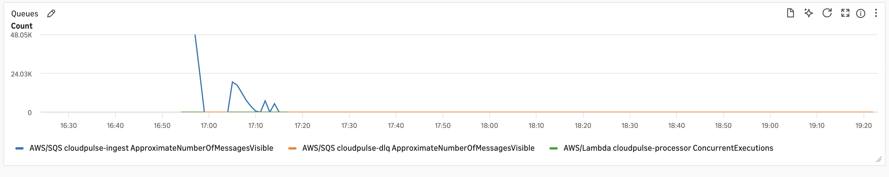

# CloudPulse

[](https://github.com/VishakBaddur/CloudPulse/actions/workflows/ci.yml)

An event-driven, serverless log analytics pipeline on AWS. Services publish log events to SQS, a Lambda function validates them and writes each one exactly once to DynamoDB along with per-minute aggregates, and CloudWatch tracks throughput, latency and failures. All infrastructure is defined in Terraform and every change is verified by integration tests in GitHub Actions.

**Stack:** AWS Lambda (Python 3.13), SQS, DynamoDB, CloudWatch, Terraform, GitHub Actions, LocalStack

## Architecture



1. Producers send JSON log events to the ingest queue.
2. The Lambda event source mapping delivers batches of up to 10 messages.
3. For each record the processor:
   - validates the event; malformed events go straight to the DLQ
   - writes the event and increments its aggregate in a single DynamoDB transaction
   - reports only failed records back to SQS so successful ones are not retried
4. Records that keep failing are moved to the DLQ by the SQS redrive policy.

## Reliability design

| Concern | How it is handled |
|---|---|
| Duplicate delivery | SQS is at-least-once. The event write uses `attribute_not_exists(event_id)` inside a `TransactWriteItems` call with the aggregate update, so a redelivered event is detected and neither stored nor counted twice. |
| Partial batch failure | The function returns `batchItemFailures`, so only failed records go back to the queue. |
| Transient errors | Failed records get their visibility timeout extended with exponential backoff and jitter (2s, 4s, 8s ... capped at 300s). boto3 uses adaptive retries, and transaction conflicts are retried in-process with jittered backoff. |
| Poison messages | Validation errors are sent directly to the DLQ with the reason attached as message attributes, without wasting retries. |
| Repeated failures | Redrive policy moves a message to the DLQ after 5 deliveries. A CloudWatch alarm fires when the DLQ is not empty. |
| Hot aggregate keys | Aggregate writes are spread across 10 shards per (source, minute, level) to avoid transaction conflicts under concurrency. |
| Crash mid-batch | The batch is redelivered after the visibility timeout. Events already written are recognized as duplicates. |

### Data model

**`cloudpulse-events`** (partition key `event_id`): one item per event, with a TTL on `expires_at` (7 days by default).

**`cloudpulse-aggregates`** (partition key `source`, sort key `bucket_key`): per-minute counters, where `bucket_key = <minute>#<level>#<shard>`, for example `2026-11-15T23:31#ERROR#03`.

### Event format

```json
{
  "event_id": "run1a2b3c4d-00000042",
  "source": "checkout-api",
  "level": "ERROR",
  "message": "upstream timeout after 3012ms",
  "timestamp": "2026-11-15T23:31:42Z",
  "attributes": {"region": "us-east-1"}
}
```

`timestamp` accepts ISO 8601 or epoch milliseconds. `level` is one of DEBUG, INFO, WARN, ERROR, FATAL.

## Observability

The processor publishes 8 custom metrics in the `CloudPulse` namespace using the CloudWatch Embedded Metric Format, so metrics cost no extra API calls and add no latency to processing.

| Metric | Unit | Meaning |
|---|---|---|
| `EventsReceived` | Count | Records delivered to the function |
| `EventsProcessed` | Count | New events written |
| `DuplicatesSkipped` | Count | Redelivered events detected by the idempotency check |
| `ValidationErrors` | Count | Malformed events sent to the DLQ |
| `RetryableErrors` | Count | Records returned to SQS for retry |
| `ErrorLevelEvents` | Count | Processed events with level ERROR or FATAL |
| `EndToEndLatencyMs` | Milliseconds | SQS send time to successful write |
| `BatchDurationMs` | Milliseconds | Time to process one batch |

Terraform also creates 4 alarms (DLQ not empty, backlog age, retry rate, p99 latency) and a dashboard with throughput, p50/p95/p99 latency, reliability and queue depth widgets.

## Fault injection

When the function is deployed with `fault_injection_enabled = true`, an event can carry a `fault` field to trigger a controlled failure. Five scenarios are covered by the integration tests:

| Scenario | Trigger | Expected result |
|---|---|---|
| Transient error | `"fault": "transient_error"` | Fails twice, recovers through backoff retries, stored once |
| Permanent error | `"fault": "permanent_error"` | Fails every delivery, redriven to the DLQ after 5 attempts |
| Poison message | malformed body | Sent straight to the DLQ on first delivery with the validation reason |
| Duplicate delivery | same `event_id` sent again | Stored and counted exactly once |
| Crash after write | `"fault": "crash_after_write"` | Function dies after writing, batch is redelivered, no double counting |

Fault injection is disabled by default and is only enabled for the LocalStack test deployment.

## Testing

32 integration tests run against the deployed stack, not mocks. In CI, the stack is deployed to LocalStack with Terraform inside the GitHub Actions runner, and the tests drive real SQS to Lambda to DynamoDB flows.

| File | Tests | Covers |
|---|---|---|
| `test_infrastructure.py` | 6 | Redrive policy, timeouts, key schemas, TTL, event source mapping |
| `test_pipeline.py` | 8 | End-to-end storage, aggregates, 200-event batch with zero loss, timestamps, levels |
| `test_idempotency.py` | 4 | Repeated sends, in-batch duplicates, conflicting payloads, concurrent double sends |
| `test_faults.py` | 9 | The 5 fault scenarios, mixed batch partial failure, invalid event rejection |
| `test_handler_contract.py` | 5 | Direct invocation: partial failure response, crash surfaces as a function error |

Loss and duplicates are checked by `loadgen/verify.py`: every expected `event_id` must be in the events table, and the aggregate counters must sum to exactly the number of stored events.

## Results

Measured on AWS in us-east-2: Lambda arm64 with 256 MB, Python 3.13, SQS batch size 10.

### 100K event run

100,000 synthetic events were sent by 32 producer threads in 16.5 s (about 6,000 events/s into SQS).
The pipeline drained them in 264 s with Lambda concurrency capped at 10, then `loadgen/verify.py`
checked every event_id and the aggregate counters.

| Expected | Stored | Missing | Unexpected | Double counted |
|---|---|---|---|---|
| 100,000 | 100,000 | 0 | 0 | 0 |

Raw output: `benchmarks/results/aws100k-verify.json`

### Throughput and latency

| Scenario | Lambda concurrency | Events | Throughput (events/s) | p50 (ms) | p95 (ms) | p99 (ms) |
|---|---|---|---|---|---|---|
| Burst, 20K at once | 2 | 20,000 | 66.4 | 143,622 | 281,942 | 294,263 |
| Burst, 20K at once | 5 | 20,000 | 160.3 | 58,666 | 113,844 | 118,609 |
| Burst, 20K at once | 10 | 20,000 | 414.0 | 20,482 | 40,934 | 42,900 |
| Steady 100 events/s for 60 s | 10 | 6,000 | 100.1 | 38 | 83 | 106 |
| Steady 250 events/s for 60 s | 10 | 15,000 | 249.8 | 50 | 108 | 156 |

- Latency is measured for every event, from the SQS `SentTimestamp` to the DynamoDB commit (`processed_at`).
- **Burst** rows measure throughput. Their latency is mostly time spent waiting in the queue, which shows the
  backlog being absorbed without loss. Throughput scales almost linearly with concurrency: 66, 160 and 414 events/s.
- **Steady** rows send below capacity, so their latency is true processing latency: p99 of 156 ms at 250 events/s.
- The `EndToEndLatencyMs` CloudWatch metric agrees with the exact values (at 250 events/s: p95 125 ms vs 108 ms,
  p99 173 ms vs 156 ms; CloudWatch percentiles are approximate).

Raw output: `benchmarks/results/benchmark-*.json`. Reproduce with:

```bash
python -m benchmarks.run_benchmark --burst-size 20000 --concurrency 2 5 10 --rates 100 250
```

### CloudWatch dashboard

The 100K run (around 16:55 UTC) and the benchmark bursts (17:05 to 17:20 UTC) on the dashboard Terraform creates.
The DLQ stays at zero throughout.





## Project layout

| Path | Contents |
|---|---|
| `src/processor/` | Lambda function (handler, validation, metrics, fault injection) |
| `loadgen/` | Synthetic event producer and loss/duplicate verifier |
| `infra/` | Terraform (SQS, DynamoDB, Lambda, IAM, alarms, dashboard) |
| `infra/envs/` | Per-environment variable files |
| `tests/integration/` | Integration tests against the deployed stack |
| `.github/workflows/` | CI pipeline |

## Running locally

Requirements: Python 3.13, Terraform 1.6+, Docker.

```bash
python3.13 -m venv .venv && source .venv/bin/activate
pip install -r requirements-dev.txt

# Start LocalStack and deploy the stack into it
docker compose up -d
cd infra
terraform workspace new local
tflocal init
tflocal apply -var-file=envs/local.tfvars -auto-approve
cd ..

# Send events and verify them
source scripts/local-env.sh
python -m loadgen.producer --count 1000 --run-id demo
python -m loadgen.verify --run-id demo --expected 1000 --wait 300

# Run the test suite
python -m pytest tests/integration -v
```

## Deploying to AWS

```bash
aws login --profile cloudpulse      # temporary credentials, no access keys
source scripts/aws-env.sh           # profile and region for CLI, boto3 and Terraform
cd infra
terraform workspace select default
terraform init
terraform apply -var-file=envs/aws.tfvars
```

This uses arm64 Lambda, fault injection off, and creates the alarms and dashboard.
The region is `us-east-2` because this account is an AWS project sandbox whose guardrail policy
only allows regional services in the project's home region; change `envs/aws.tfvars` for other accounts.
At this scale everything is on-demand or within the free tier. Remove it with
`terraform destroy -var-file=envs/aws.tfvars`.
